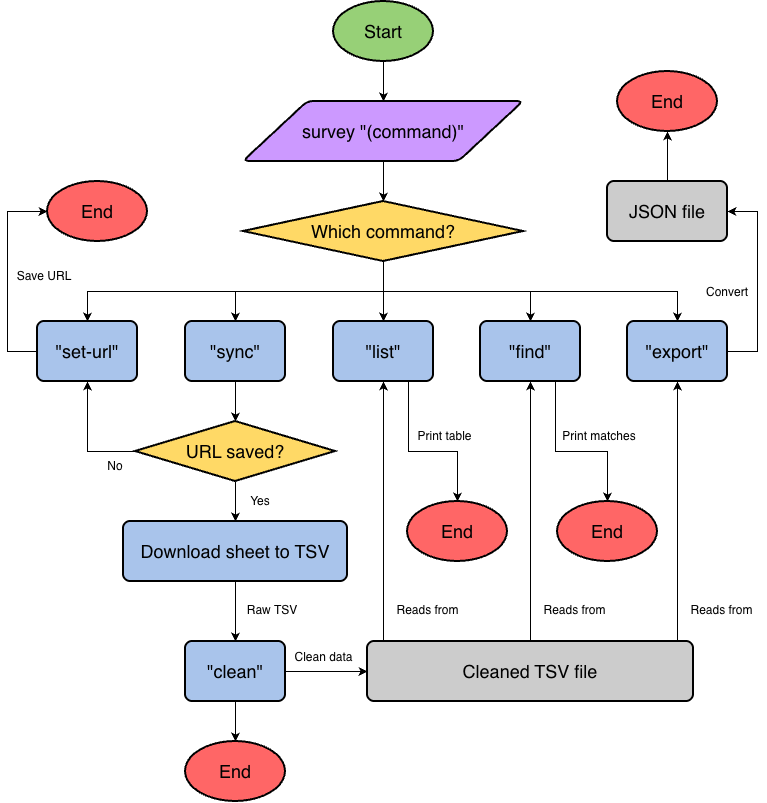

# Survey Parser

A Bash command-line tool that downloads Google Form responses and lets you search, compare, and export them.

(For the sake of privacy, all info in this project repository is anonymized as a general "Survey Parser" rather than my intended "(Redacted) Alumni Archive" name to hide personal details.)

## The Problem

Though I was born in the U.S., my childhood was spent overseas as an expat, where I attended an international school for roughly 10 years. Now that I've grown up, all of my old friends have scattered, living their own lives spread throughout many different countries across the world. I wish I had an easy way to collect and browse everyone's information, such as where and when they lived there, favorite memories, notable experiences, how to reach them again, etc.

## How It Works

This tool pulls responses from a Google Sheet (connected to a Google Form), formats the information nicely, and saves it in a local TSV file. You can then browse and search that file with simple commands, find certain people or categories, and export everything as a JSON.

For my personal use, I sent a Google Form to all of my old friends with questions and short-answer responses to gather their input. This project is an easy way for me to parse through the data and export it if I eventually decide to host everything on a website for us to share.



## Tech Stack

- **Language:** Bash
- **External tools:** curl, awk, sed, tr, sort, cut, grep, column
- **Data:** Google Form connected to a Google Sheet, stored as a TSV

## Setup

```bash
git clone https://github.com/hudsoncote/survey-parser
cd survey-parser
chmod +x survey.sh
```

The Google Sheet must be shared as "anyone with the link can view."
The included fake sample data can be used to try the tool without your own Form/Sheet.

## Usage

```
./survey.sh set-url "Sheet URL"                           # saves the Google Sheet URL
./survey.sh sync                                          # downloads the Sheet as a TSV
./survey.sh clean                                         # formats messy data nicely
./survey.sh list                                          # lists all data in a table
./survey.sh find --location "Name" --years 2015-2018      # searches data by certain tags
./survey.sh export json                                   # exports data as a JSON
```

## Roadmap

- [ ] CSV export
- [ ] "--public" export that hides contact info
- [ ] Website for sharing the directory

## Author

Hudson Cote, github.com/hudsoncote
